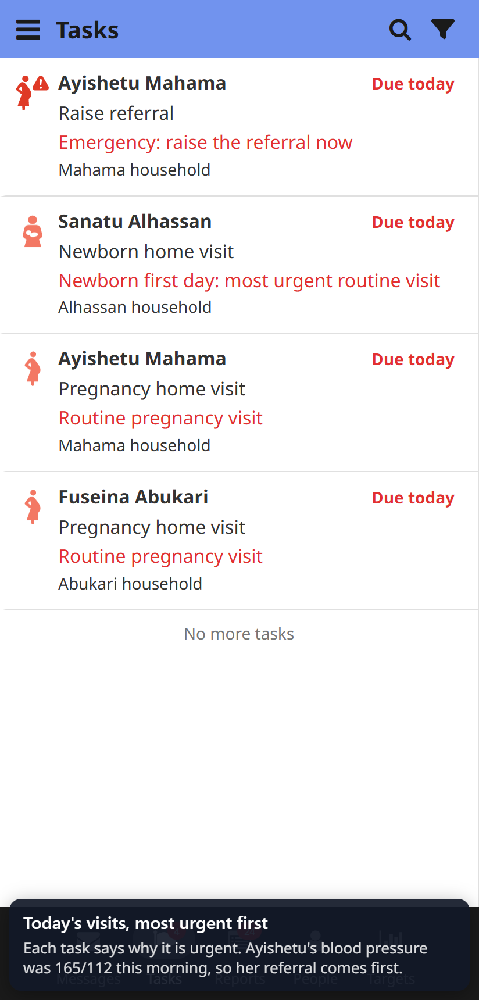
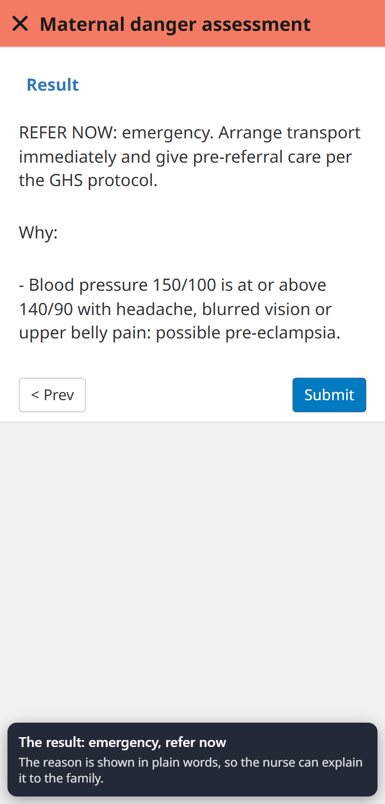
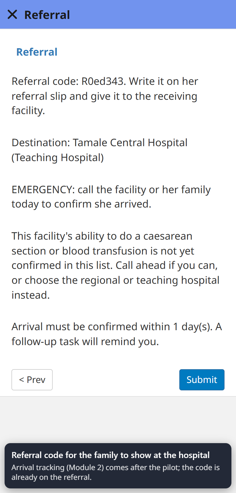
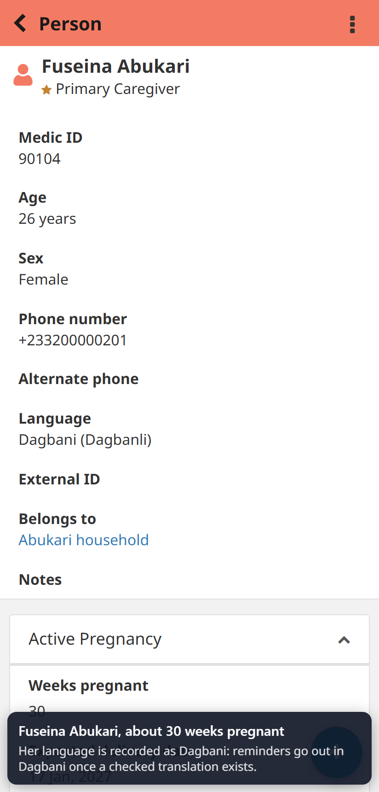

# Demo script: five minutes in the pilot app

Written for: the person presenting the demo to a district team, a funder or a partner.
Set-up and the demo district are described in `DEMO_SETUP.md`.

**Before the meeting**
1. Re-seed the demo that morning (`npm run demo-seed`, `DEMO_SETUP.md`).
2. Start the tunnel and open the link on a phone (Chrome or the CHT Android app). Log in as
   `demo_nurse_dalun`. Wait for the task list to load.
3. Have the walkthrough video (`DEMO_SETUP.md`) open as a backup.

**Say the status first:** "Everyone you will see is made up. Nothing here is clinically approved yet:
that is the next step, with a clinical advisor and the district."

## 1. Today's visits, most urgent first (45 seconds)

**Tasks** tab. Point to the top row: Ayishetu Mahama, **Raise referral**, "Emergency: raise the referral
now". Below it: Sanatu's newborn, "Newborn first day: most urgent routine visit".

Say: "The nurse starts her day here. The app puts the most urgent visit first and says why, so a
danger sign found yesterday is not buried under routine visits."

## 2. Register a pregnancy (1 minute)

**People** → Dalun CHPS zone (demo) → Iddrisu household → **Mariama Iddrisu** → **New action** →
**Pregnancy registration**. Last menstrual period about three months ago; answer "No" to the danger
signs; submit.

Say: "This is the register the nurse keeps on paper today. Once it is in the app, it counts toward the
monthly report without anyone tallying it again."

## 3. A danger sign, found at the visit (1 minute)

**People** → **Fuseina Abukari** → **New action** → **Maternal danger assessment**. Pregnant; blood
pressure **150/100**, temperature 36.9; **severe headache: Yes**, everything else No.

Point to the result: "REFER NOW: emergency ... possible pre-eclampsia", with the reason in plain words.

Say: "Neither the blood pressure nor the headache alone is an emergency. Together they are. The app
applies the rule every time, and gives the nurse the words to explain it to the family."

## 4. Raise the referral (45 seconds)

Submit, go back to **Tasks**: "Raise referral" for Fuseina is now at the top. Open it: emergency;
Northern Region; Tamale Central Hospital; her husband is present and is the one who decides. Point to
the **referral code** on the last page.

Say: "An emergency can only be sent to a hospital. The code goes on her referral slip. Confirming that
she arrived is the next module, after the pilot."

## 5. Her language (20 seconds)

Fuseina's profile: **Language: Dagbani (Dagbanli)**.

Say: "Every client's language is recorded. Reminders go out in Dagbani once a translation has been
checked by a second speaker and approved; until then they go in English and the nurse interprets.
We do not send machine translations to patients."

## 6. The month's numbers (1 minute)

**Targets** tab: births, pregnancies and referrals this month, counted from the nurse's own records.

Then the Module 5 file for last month (`cht-app/.demo-out/module5_<month>_DEMO.csv`, or the last part
of the video): one row per CHPS zone and measure, exact counts.

Say: "This is the file the district imports into DHIMS-2. It is built from the visits, so the paper
tally can stop. The identifiers in it are demo ones; for a real district they come from DHIMS-2."

## Close (20 seconds)

"What we need next: a clinical advisor, the district's agreement, ethics approval, and five nurses in
Kumbungu using it for six weeks, so we can show whether it helps."

## What not to claim

- No outcome, lives-saved or cost-saving figures. None exist yet.
- No clinical approval, district agreement or GHS endorsement.
- No live SMS, no Dagbani text in use, no speech recognition.
- Not "integrated with DHIMS-2": the file is in DHIMS-2's import format; no real import has been done.
- The demo server is not where real data would go. Real data stays in Ghana.

## If something fails

Say what failed and switch to the video. A demo that admits a fault is more credible than one that
hides it. Afterwards, re-seed and run `node demo/walkthrough.js` to find the step that broke.
